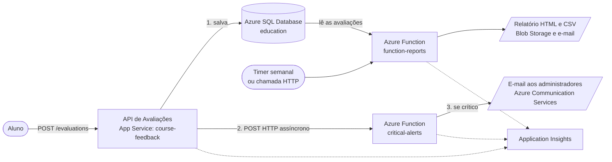
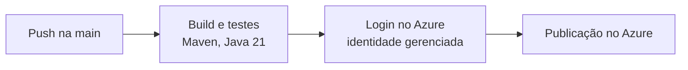

# Tech Challenge FIAP — Fase 4 — Grupo 32

Plataforma de feedback de aulas, hospedada na **Microsoft Azure**, com funções **serverless** para alertar os administradores sobre feedbacks críticos e gerar relatórios semanais.

## Contexto

Para garantir a qualidade dos cursos on-line, os estudantes precisam poder avaliar as aulas e os administradores precisam acompanhar rapidamente a satisfação dos alunos. O sistema:

- recebe avaliações dos alunos (descrição e nota de 0 a 10);
- classifica cada avaliação por urgência;
- envia um **e-mail automático** aos administradores quando o feedback é crítico;
- gera um **relatório semanal** com a média das notas e a distribuição das avaliações.

## Arquitetura



### Componentes

| Componente | Pasta | Serviço Azure | Responsabilidade |
|---|---|---|---|
| API de avaliações | [`feedbackapi`](./feedbackapi) | App Service (`course-feedback`) | Receber e consultar avaliações, classificar a urgência e acionar a função de alertas |
| Função de alertas | [`function-alerts`](./function-alerts) | Function App (`critical-alerts`) | Analisar a criticidade do feedback e enviar o e-mail de alerta |
| Função de relatórios | [`function-reports`](./function-reports) | Function App (`function-reports`) | Gerar e publicar o relatório semanal |
| Banco de dados | — | Azure SQL Database (`education`, servidor `postech-education`) | Armazenar as avaliações |
| Monitoramento | — | Application Insights | Logs, métricas, falhas e dashboards |

Cada componente tem uma única responsabilidade: a API cuida das avaliações, a função de alertas só decide e notifica, e a função de relatórios só consolida os dados.

## Como o fluxo funciona

### 1. Envio de uma avaliação

1. O aluno envia `POST /evaluations` com a descrição e a nota.
2. A API classifica a urgência pela nota e salva a avaliação no **Azure SQL**.
3. Em seguida, a API faz uma chamada HTTP **assíncrona** (`POST`) para a **função de alertas**. Isso não atrasa a resposta ao aluno, e uma falha na função não impede o registro da avaliação.
4. A função de alertas analisa o feedback. Se for **crítico**, envia um e-mail aos administradores com a **descrição**, a **urgência** e a **data de envio**.

Não há fila nem Service Bus: a integração é uma chamada HTTP direta, o que mantém a solução simples e barata.

### 2. Classificação de urgência

| Nota | Urgência | Ação |
|---|---|---|
| 0 a 3 | Crítica | Dispara o e-mail de alerta |
| 4 a 6 | Revisar | Apenas registro em log |
| 7 a 10 | OK | Apenas registro em log |

A função de alertas também considera crítico o feedback que contenha termos sensíveis na descrição (como fraude, assédio, racismo ou advogado), mesmo com nota alta.

### 3. Relatório semanal

A função de relatórios consolida as avaliações do período (7 dias por padrão) e gera:

- a **média das notas**;
- a **quantidade de avaliações por dia**;
- a **quantidade de avaliações por urgência**;
- a lista dos feedbacks, com **descrição, urgência e data de envio**.

Ela roda automaticamente por agendamento (timer) e também pode ser chamada por HTTP. O relatório sai em **HTML** e **CSV**, e pode ser publicado em **Blob Storage** e por **e-mail**, conforme a configuração do ambiente.

## Ambiente na Azure

Todos os recursos ficam no mesmo grupo de recursos (`rg-pos-tech-challenge`):

- **App Service** para a API e **Function Apps** para as duas funções (Java 21);
- **Azure SQL Database** no tier gratuito serverless, que **pausa por inatividade** (a primeira chamada depois de uma pausa pode demorar);
- **Azure Communication Services** para o envio dos e-mails de alerta;
- **Application Insights** para o monitoramento;
- uma **identidade gerenciada** usada pelo GitHub Actions para publicar os deploys.

### Configuração e segurança

- Senhas, chaves e strings de conexão ficam em **variáveis de ambiente** de cada serviço no Azure e **não são versionadas** no repositório.
- O deploy usa login federado (OIDC) com identidade gerenciada, sem senha armazenada no GitHub.
- O acesso ao banco é restrito pelo firewall do servidor SQL e exige usuário e senha.
- A rota HTTP de relatórios exige **chave de função**.

Principais variáveis por serviço:

| Serviço | Variáveis |
|---|---|
| API (`course-feedback`) | `DB_URL`, `DB_USERNAME`, `DB_PASSWORD`, `ALERTS_FUNCTION_URL` |
| Alertas (`critical-alerts`) | `ALERT_RECIPIENT_EMAIL`, `ALERT_SENDER_EMAIL`, `COMMUNICATION_SERVICES_CONNECTION_STRING` |
| Relatórios (`function-reports`) | `SQL_CONNECTION_STRING`, `REPORT_CRON`, `REPORT_PERIOD_DAYS`, `REPORT_BLOB_CONTAINER`, `SENDGRID_API_KEY`, `REPORT_EMAIL_FROM`, `REPORT_EMAIL_TO` |

Detalhes de cada variável estão no README de cada pasta.

## Deploy automatizado

Cada componente tem seu próprio workflow no **GitHub Actions** (pasta [`.github/workflows`](./.github/workflows)):

| Workflow | Publica em | Dispara quando muda |
|---|---|---|
| `deploy-feedbackapi.yml` | App Service `course-feedback` | `feedbackapi/**` |
| `deploy-function-alerts.yml` | Function App `critical-alerts` | `function-alerts/**` |
| `deploy-function-reports.yml` | Function App `function-reports` | `function-reports/**` |



Um push na `main` que altere a pasta de um componente executa o build com testes e, se passar, publica somente aquele componente. Os workflows também podem ser executados manualmente (`workflow_dispatch`).

## Monitoramento

- **Application Insights** em cada serviço: requisições, falhas, exceções e logs.
- **Dashboard** no portal do Azure com requisições, códigos de resposta e chamadas por rota.
- **Verificação de integridade** da API em `/actuator/health/liveness`; a rota `/actuator/health/readiness` também considera o banco.
- Logs em tempo real pelo **Fluxo de log** do App Service e das Function Apps.

## Como testar

Substitua os endereços pelos do seu ambiente.

```bash
# Enviar uma avaliação
curl -X POST https://<url-da-api>/evaluations \
  -H 'Content-Type: application/json' \
  -d '{"descricao":"Aula excelente","nota":9}'

# Listar avaliações (opcional: ?urgency=CRITICAL)
curl https://<url-da-api>/evaluations

# Verificar a saúde da API
curl https://<url-da-api>/actuator/health/liveness

# Gerar o relatório dos últimos 7 dias (precisa da chave da função)
curl "https://<url-function-reports>/api/relatorio?dias=7&code=<chave>"
```

Uma avaliação com nota até 3 dispara o e-mail de alerta aos administradores.

## Estrutura do repositório

```
.
├── feedbackapi/         API de avaliações (Spring Boot, Java 21)
├── function-alerts/     Azure Function de alertas críticos
├── function-reports/    Azure Function do relatório semanal
└── .github/workflows/   Pipelines de deploy
```

## Documentação por componente

- [API de avaliações](./feedbackapi/README.md)
- [Função de alertas](./function-alerts/README.md)

## Equipe

Grupo 32 — Pós Tech FIAP, Tech Challenge Fase 4.