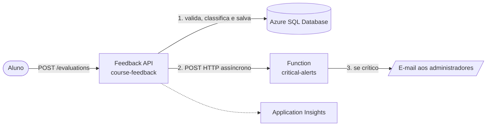

# Feedback API — API de avaliações

API REST (Spring Boot, Java 21) que recebe as avaliações dos alunos, classifica a urgência de cada uma e aciona a função de alertas quando necessário. Faz parte do Tech Challenge FIAP — Fase 4 — Grupo 32.

Em produção roda no **Azure App Service** (`course-feedback`) e grava no **Azure SQL Database**.

---

## Responsabilidades

- receber e validar avaliações (`descricao` e `nota` de 0 a 10);
- classificar a urgência pela nota e **salvar** no banco;
- **acionar a função de alertas** (`critical-alerts`) a cada avaliação salva;
- consultar avaliações, com filtro por urgência;
- expor rotas de saúde para o monitoramento.

O envio do e-mail de alerta e o relatório semanal ficam nas funções serverless, e não nesta API.

---

## Fluxo de uma avaliação



1. A API valida o corpo e calcula a **urgência**.
2. Salva a avaliação e responde `201` ao aluno.
3. Em seguida, faz uma chamada HTTP **assíncrona** (`POST`) para a função de alertas, enviando descrição, nota e data. Se a função estiver fora do ar, o erro é apenas registrado em log, sem afetar o aluno nem a avaliação salva.

### Regra de urgência

| Nota | Urgência |
|---|---|
| 0 a 3 | `CRITICAL` |
| 4 a 6 | `REVIEW` |
| 7 a 10 | `OK` |

A função de alertas aplica a própria análise, que também considera termos sensíveis na descrição.

---

## Endpoints

| Método | Rota | Descrição |
|---|---|---|
| `POST` | `/evaluations` | Cria uma avaliação |
| `GET` | `/evaluations` | Lista as avaliações (filtro opcional `?urgency=`) |
| `GET` | `/evaluations/{id}` | Busca uma avaliação pelo id |
| `GET` | `/actuator/health` | Saúde geral (inclui o banco) |
| `GET` | `/actuator/health/liveness` | O processo está vivo (não consulta o banco) |
| `GET` | `/actuator/health/readiness` | Pronto para receber tráfego (inclui o banco) |

### Criar avaliação

```bash
curl -X POST https://<url-da-api>/evaluations \
  -H 'Content-Type: application/json' \
  -d '{"descricao":"Aula excelente","nota":9}'
```

| Campo | Regra |
|---|---|
| `descricao` | Obrigatório, até 1000 caracteres |
| `nota` | Obrigatório, de 0 a 10 |

Resposta `201 Created`:

```json
{
  "id": 1,
  "descricao": "Aula excelente",
  "nota": 9,
  "urgencia": "OK",
  "createdAt": "2026-11-15T20:40:00.123"
}
```

### Listar e buscar

```bash
curl https://<url-da-api>/evaluations
curl "https://<url-da-api>/evaluations?urgency=CRITICAL"   # CRITICAL, REVIEW ou OK
curl https://<url-da-api>/evaluations/1
```

### Erros

| Código | Quando | Corpo |
|---|---|---|
| `400` | Corpo inválido (campo ausente, nota fora de 0 a 10, descrição longa demais) | `timestamp`, `status`, `error`, `message` com os campos inválidos |
| `404` | Avaliação não encontrada em `GET /evaluations/{id}` | `timestamp`, `status`, `error`, `message` |

---

## Configuração (variáveis de ambiente)

No Azure, configure em **course-feedback → Configuração → Variáveis de ambiente**.

| Variável | Descrição | Padrão | Obrigatória |
|---|---|---|---|
| `DB_URL` | Cadeia JDBC do banco | `jdbc:sqlserver://localhost:1433;databaseName=TechChallenge;...` | No Azure, sim |
| `DB_USERNAME` | Usuário do banco | `sa` | No Azure, sim |
| `DB_PASSWORD` | Senha do banco | — | **Sim** |
| `ALERTS_FUNCTION_URL` | URL da função de alertas | `https://critical-alerts.azurewebsites.net/api/alerts/process` | Não |
| `ALERTS_FUNCTION_KEY` | Chave de autenticação (Function Key) | — | Em produção, sim |
| `SERVER_PORT` | Porta da API | `8080` | Não |

Exemplo de `DB_URL` para o Azure SQL:

```
jdbc:sqlserver://<servidor>.database.windows.net:1433;database=<banco>;encrypt=true;trustServerCertificate=false;loginTimeout=60;
```

Sem essas variáveis, a API tenta conectar em `localhost:1433` e **não inicia**, e o Azure responde `503`.

O banco usa o tier gratuito serverless do Azure SQL, que **pausa por inatividade** e tem cota mensal. A primeira chamada depois de uma pausa pode demorar, e o `loginTimeout=60` evita que a conexão falhe nesse intervalo. Para o banco poder pausar, é recomendável reduzir as conexões ociosas do pool (HikariCP):

```properties
spring.datasource.hikari.minimum-idle=0
spring.datasource.hikari.maximum-pool-size=3
spring.datasource.hikari.idle-timeout=60000
```

---

## Ambiente na Azure

| Recurso | Uso |
|---|---|
| App Service `course-feedback` | Hospeda a API (Java 21) |
| Azure SQL Database | Armazena as avaliações (as tabelas são criadas pela aplicação) |
| Function App `critical-alerts` | Recebe cada avaliação salva e envia o alerta, se crítico |
| Application Insights `course-feedback` | Requisições, falhas, exceções e logs |

**Verificação de integridade:** em *Monitoramento → Verificação de integridade* do App Service, o caminho configurado é `/actuator/health/liveness`. Ela não consulta o banco, então uma pausa do banco serverless não faz o Azure reiniciar a API. A rota `/actuator/health/readiness` inclui o banco e serve para saber se a API está pronta para atender.

---

## Deploy automatizado

O workflow [`deploy-feedbackapi.yml`](../.github/workflows/deploy-feedbackapi.yml) publica a API.

- **Quando roda:** a cada push na `main` que altere `feedbackapi/**`, ou manualmente (`workflow_dispatch`).
- **Etapas:** build com Maven e Java 21 (`mvn clean install`, que executa os testes), login no Azure por identidade gerenciada (OIDC) e publicação do JAR no App Service `course-feedback` (slot `Production`).

Se o build ou os testes falharem, nada é publicado.

---

## Monitoramento

- **Application Insights:** requisições, códigos de resposta, falhas e exceções. Há um dashboard no portal com requisições por período, códigos de resposta e chamadas por rota.
- **Fluxo de log** do App Service para acompanhar a inicialização em tempo real.
- Mensagens `[ALERTS CLIENT]` nos logs mostram se o disparo para a função de alertas deu certo.

Consulta útil (aba **Logs** do Application Insights):

```kusto
requests
| summarize Total=count() by resultCode
| render piechart
```

---

## Rodar localmente

**Pré-requisitos:** Java 21 e Docker com Docker Compose.

**1. Subir o banco (SQL Server)**

```bash
docker compose up -d
```

Na pasta `feedbackapi`, sobe um SQL Server 2022 em `localhost:1433` e cria o banco `TechChallenge`. A senha padrão do usuário `sa` é `Feedback@Local123`. Para outra senha: `DB_PASSWORD='OutraSenha@123' docker compose up -d`.

**2. Rodar a API**

```bash
DB_PASSWORD='Feedback@Local123' ./mvnw spring-boot:run
```

A API sobe em `http://localhost:8080`. No IntelliJ, defina `DB_PASSWORD` em *Run → Edit Configurations → Environment variables*. Localmente, a chamada à função de alertas vai para o endereço padrão no Azure; para evitar isso, aponte `ALERTS_FUNCTION_URL` para uma URL local ou de teste.

**3. Testar**

```bash
curl -X POST http://localhost:8080/evaluations \
  -H 'Content-Type: application/json' \
  -d '{"descricao":"Aula excelente","nota":9}'

curl http://localhost:8080/evaluations
```

**Parar o banco**

```bash
docker compose down      # mantém os dados
docker compose down -v   # apaga os dados
```

### Coleção do Postman

A pasta [`postman`](./postman) tem a coleção `tech-challenge-evaluations-collection.json`, com as chamadas de criar, listar e buscar avaliação. Defina a variável `baseUrl` com o endereço da API (local ou do Azure).

---

## Testes

```bash
./mvnw test
```

Os testes usam um banco H2 em memória, então não precisam do Docker. Cobrem a aplicação, o controller e o serviço de avaliações.