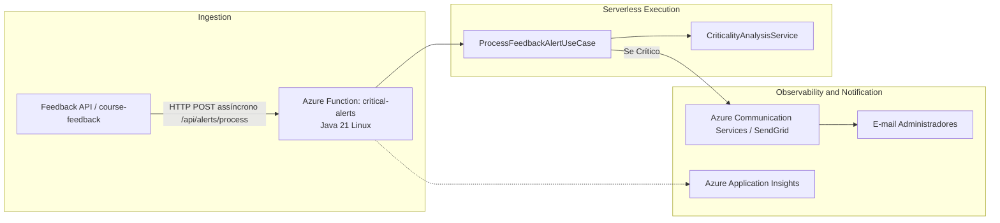

# Function Alerts — Serverless Criticality Analysis & Notifications (100% Azure)

Microsserviço Serverless nativo para a nuvem **Microsoft Azure**, responsável pela análise de criticidade e emissão de alertas administrativos para feedbacks de alunos, desenvolvido para o Tech Challenge FIAP (Fase 4 - Grupo 32).

Desenvolvido sob os princípios de **Clean Architecture**, **Single Responsibility Principle (SRP)** e fortemente tipado em **Java 21**.

---

## ☁️ Topologia Serverless no Azure (HTTP Trigger Direto)



---

## 🏛️ Componentes da Arquitetura Limpa

1. **Domínio (`domain/`)**:
   - `Feedback`: Entidade imutável (record) com validação de invariantes (descrição não nula, nota entre 0 e 10, timestamp).
   - `UrgencyLevel`: Enumeração padronizada no ecossistema (`CRITICO`, `REVISAR`, `OK`).
   - `CriticalityAnalysisService`: Serviço de domínio puro (SRP) contendo as regras de classificação e detecção de palavras-chave sensíveis normalizadas.
   - `CriticalityResult`: Value Object informando se é crítico, motivo e nível formatado.

2. **Aplicação (`application/`)**:
   - `FeedbackEventDto`: DTO de entrada mapeando o evento assíncrono do Service Bus.
   - `NotificationPayload`: Estrutura obrigatória contendo:
     - **Descrição do feedback**
     - **Urgência** (ex: `CRÍTICO`)
     - **Data de envio** formatada
   - `NotificationSenderPort`: Interface de saída que desacopla a regra de negócio do provedor de e-mail.
   - `ProcessFeedbackAlertUseCase`: Orquestrador responsável por validar o evento, chamar a análise de criticidade e notificar apenas feedbacks críticos (se for `REVISAR` ou `OK`, encerra com log).

3. **Infraestrutura Azure (`infrastructure/`)**:
   - `AzureFunctionAlertsHandler`: Ponto de entrada Serverless anotado com `@FunctionName("processFeedbackAlerts")` e `@HttpTrigger(route = "alerts/process")`.
   - `AzureEmailNotificationAdapter`: Adaptador de saída via API REST do Azure Communication Services / SendGrid com fallback/simulação local.

---

## 📋 Regra de Negócio Implementada

Padronizada em conformidade com as Pessoas 2 e 4:
- **`CRÍTICO`**: `nota <= 3` OU presença de termos de alerta sensíveis (*processo, fraude, péssimo, horrível, denúncia, urgente, abandono, advogado, assédio, racismo, humilhação, preconceito, descaso, inaceitável*) $\rightarrow$ **Dispara Alerta Automático**.
- **`REVISAR`**: `nota` entre $4$ e $6$ (sem termos sensíveis) $\rightarrow$ Registra log de auditoria pedagógica e **não envia e-mail**.
- **`OK`**: `nota` entre $7$ e $10$ (sem termos sensíveis) $\rightarrow$ Registra log de auditoria com sucesso e **não envia e-mail**.

---

## ⚙️ Variáveis de Ambiente no Azure

Configuradas nas *Application Settings* do Function App (`critical-alerts`) ou em `local.settings.json`:

| Variável | Descrição | Exemplo |
| :--- | :--- | :--- |
| `ALERT_RECIPIENT_EMAIL` | Destinatário dos alertas administrativos | `coordenacao-feedbacks@instituicao.edu.br` |
| `ALERT_SENDER_EMAIL` | Remetente configurado no Azure Communication Services | `DoNotReply@<managed-domain>.azurecomm.net` |
| `COMMUNICATION_SERVICES_CONNECTION_STRING` | Connection String do recurso Azure Communication Services | `endpoint=https://<recurso>.communication.azure.com/;accesskey=...` |

---

## 🚀 Provisionamento da Infraestrutura na Azure (IaC)

A pasta [`infra/`](./infra) contém os scripts de Infraestrutura como Código (IaC):

1. **Bicep Declarativo**: [`main.bicep`](./infra/main.bicep) cria automaticamente:
   - Resource Group
   - Storage Account Serverless
   - Log Analytics Workspace + Application Insights
   - Azure Service Bus Namespace + Fila `feedbacks-queue`
   - Linux Consumption Plan (Y1)
   - Function App com runtime Java 21 configurada

2. **Deploy com Azure CLI**:
   ```powershell
   cd infra
   az login
   az deployment group create --resource-group rg-techchallenge-fase4 --template-file ./main.bicep
   ```

---

## 🧪 Execução dos Testes Unitários

```bash
mvn clean test
```

Suite completa cobrindo 100% dos caminhos críticos (notas de 0 a 10, palavras acentuadas, simulação de envio com Mockito e validação dos 3 campos obrigatórios no payload).
