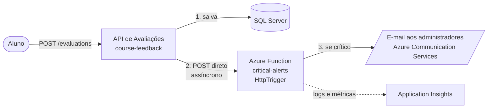

# Function Alerts — Análise de criticidade e alertas por e-mail

Azure Function (Java 21) responsável por analisar a criticidade dos feedbacks de alunos e avisar os administradores por e-mail quando o feedback é crítico. Faz parte do Tech Challenge FIAP — Fase 4 — Grupo 32.

O código segue **Clean Architecture** e o princípio de **responsabilidade única**: a função só decide se o feedback é crítico e notifica. Salvar e consultar avaliações é papel da API.

---

## Fluxo

A função é acionada por uma chamada **HTTP direta** da API de avaliações, usando um **HttpTrigger**. Não há fila nem Azure Service Bus.



1. O aluno envia a avaliação para a API (`POST /evaluations`).
2. A API **salva** a avaliação no banco.
3. Logo depois, a API faz um `POST` HTTP **assíncrono** para esta função, com a descrição, a nota e a data de envio. O envio não bloqueia a resposta ao aluno. Se a função estiver indisponível, a API apenas registra o erro em log e a avaliação continua salva.
4. A função analisa o feedback.
    - **Crítico:** envia o e-mail de alerta aos administradores.
    - **Revisar** ou **OK:** apenas registra em log, sem e-mail.

### O que isso muda na prática

- **Não é necessário** criar Azure Service Bus (namespace, fila e custos extras).
- Basta existir a **Function App** (`critical-alerts`) e a variável com a URL da função na API (`ALERTS_FUNCTION_URL`).

---

## Endpoint

| Item | Valor |
|---|---|
| Função | `processFeedbackAlerts` |
| Rota | `POST /api/alerts/process` |
| URL | `https://<function-app>.azurewebsites.net/api/alerts/process` |
| Autenticação | `ANONYMOUS` (veja a seção de segurança) |

**Corpo da requisição**

```json
{
  "descricao": "Texto do feedback do aluno",
  "nota": 2,
  "data_envio": "2026-11-15T18:00:00"
}
```

O campo `data_envio` é opcional; se não vier, a função usa o horário atual.

**Respostas**

| Código | Quando |
|---|---|
| `200` | Feedback analisado. A resposta é a mesma para feedbacks críticos e não críticos, então o código HTTP não indica se um e-mail foi enviado. |
| `400` | Corpo da requisição vazio |
| `500` | Erro ao processar o feedback |

**Exemplo**

```bash
curl -X POST https://<function-app>.azurewebsites.net/api/alerts/process \
  -H 'Content-Type: application/json' \
  -d '{"descricao":"Aula excelente","nota":9}'
```

Um feedback crítico (por exemplo, nota 2) envia um e-mail de verdade ao destinatário configurado.

---

## Regra de criticidade

| Urgência | Condição | Ação |
|---|---|---|
| **CRÍTICO** | nota **≤ 3**, **ou** a descrição contém um termo de alerta | Envia o e-mail de alerta |
| **REVISAR** | nota de 4 a 6, sem termos de alerta | Registra em log, sem e-mail |
| **OK** | nota de 7 a 10, sem termos de alerta | Registra em log, sem e-mail |

**Termos de alerta** (comparados sem acento e como palavra inteira): processo, fraude, péssimo, horrível, denúncia, urgente, abandono, advogado, assédio, racismo, humilhação, preconceito, descaso, inaceitável.

---

## E-mail de alerta

Enviado pelo **Azure Communication Services (Email)** e contém:

- **Descrição** do feedback;
- **Urgência** (`CRÍTICO`);
- **Data de envio**.

Sem a variável `COMMUNICATION_SERVICES_CONNECTION_STRING`, a função entra em modo de **simulação**: não envia e-mail e apenas escreve o conteúdo no log.

---

## Arquitetura do código

```
function-alerts/src/main/java/.../function_alerts
├── domain/            Regras de negócio puras
│   ├── model/         Feedback, UrgencyLevel, CriticalityResult
│   └── service/       CriticalityAnalysisService (regra de criticidade)
├── application/       Casos de uso
│   ├── dto/           FeedbackEventDto (entrada), NotificationPayload (e-mail)
│   ├── port/          NotificationSenderPort (interface de envio)
│   └── usecase/       ProcessFeedbackAlertUseCase
└── infrastructure/    Detalhes do Azure
    ├── serverless/    AzureFunctionAlertsHandler (HttpTrigger)
    └── adapter/       AzureEmailNotificationAdapter (Azure Communication Services)
```

- **Domínio:** decide a urgência e não conhece o Azure.
- **Aplicação:** orquestra a análise e notifica apenas os feedbacks críticos, sem depender do provedor de e-mail.
- **Infraestrutura:** recebe a requisição HTTP e envia o e-mail. O provedor pode ser trocado sem mexer nas regras.

---

## Configuração (variáveis de ambiente)

Definidas em **Function App `critical-alerts` → Configuração → Variáveis de ambiente**, ou em `local.settings.json` para rodar localmente (use o `local.settings.json.example` como modelo).

| Variável | Descrição | Exemplo |
|---|---|---|
| `ALERT_RECIPIENT_EMAIL` | Destinatário dos alertas | `coordenacao@instituicao.edu.br` |
| `ALERT_SENDER_EMAIL` | Remetente configurado no Azure Communication Services | `DoNotReply@<dominio-gerenciado>.azurecomm.net` |
| `COMMUNICATION_SERVICES_CONNECTION_STRING` | Cadeia de conexão do Azure Communication Services | `endpoint=https://<recurso>.communication.azure.com/;accesskey=<chave>` |
| `APPLICATIONINSIGHTS_CONNECTION_STRING` | Liga a função ao Application Insights | gerada pelo recurso |
| `FUNCTIONS_WORKER_RUNTIME` | Runtime da função | `java` |
| `AzureWebJobsStorage` | Conta de armazenamento exigida pelo Azure Functions | cadeia de conexão |

Na **API de avaliações**, a variável `ALERTS_FUNCTION_URL` deve apontar para esta função (padrão: `https://critical-alerts.azurewebsites.net/api/alerts/process`).

Não versione chaves nem cadeias de conexão reais.

---

## Deploy automatizado

O workflow [`deploy-function-alerts.yml`](../.github/workflows/deploy-function-alerts.yml) publica a função no Azure.

- **Quando roda:** a cada push na `main` que altere `function-alerts/**`, ou manualmente (`workflow_dispatch`).
- **Etapas:** build com Maven (Java 21) e testes, login no Azure por identidade gerenciada (OIDC) e publicação na Function App `critical-alerts`.

---

## Monitoramento

Com o **Application Insights** vinculado à função, é possível acompanhar:

- execuções e falhas da função `processFeedbackAlerts`;
- erros de processamento e do envio de e-mail;
- chamadas feitas pela API, vistas como dependências no Application Insights da API.

Exemplo de consulta (aba **Logs** do Application Insights da função):

```kusto
requests
| where operation_Name has "processFeedbackAlerts"
| summarize Execucoes=count(),
            Falhas=countif(success == false or toint(resultCode) >= 400)
  by bin(timestamp, 5m)
| render timechart
```

Mensagens úteis de log: `Requisição HTTP recebida`, `Processamento finalizado com sucesso` e `Erro crítico no processamento`.

---

## Segurança

- A rota está com autenticação `ANONYMOUS`, ou seja, qualquer cliente que conheça a URL pode chamá-la e, em caso de feedback crítico, disparar um e-mail. Para endurecer, mude para `AuthorizationLevel.FUNCTION` e passe a chave na chamada da API.
- Chaves e cadeias de conexão ficam apenas em variáveis de ambiente do Azure.

---

## Testes

```bash
./mvnw clean test
```

Os testes unitários cobrem a regra de criticidade, o caso de uso, o adaptador de e-mail (com simulação) e o handler HTTP.

---

## Infraestrutura como código (`infra/`)

A pasta [`infra`](./infra) contém scripts Bicep e PowerShell de uma versão anterior da solução, que previa **Service Bus** e um plano Consumption. O fluxo atual **não usa Service Bus**. Revise ou remova esses recursos antes de reutilizar os scripts.