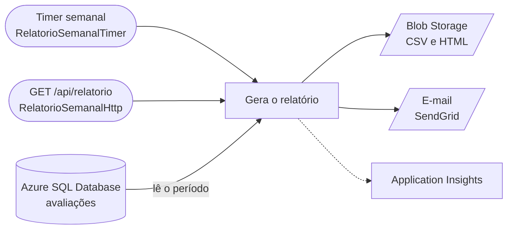

# Function Reports — Relatório semanal de feedbacks

Azure Function (Java) responsável por consolidar as avaliações dos alunos e gerar o **relatório semanal** para os administradores. Faz parte do Tech Challenge FIAP — Fase 4 — Grupo 32.

A função só **lê** as avaliações e monta o relatório. Receber avaliações é papel da API, e alertar sobre feedbacks críticos é papel da função de alertas.

---

## O que o relatório traz

Para o período analisado (os últimos **7 dias** por padrão), o relatório contém:

- **média das notas**;
- **quantidade de avaliações por dia**;
- **quantidade de avaliações por urgência** (`CRITICO`, `REVISAR` e `OK`);
- a **lista de feedbacks**, com descrição, urgência e data de envio.

Ele é gerado em **HTML** (para leitura) e em **CSV** (para planilhas).

---

## Como funciona



A função tem dois gatilhos:

| Função | Gatilho | Para que serve |
|---|---|---|
| `RelatorioSemanalTimer` | Agendamento (variável `REPORT_CRON`) | Gera e **publica** o relatório automaticamente toda semana |
| `RelatorioSemanalHttp` | `GET /api/relatorio` | Consultar o relatório sob demanda e, se quiser, publicá-lo |

### Publicação

Depois de gerar o relatório, a função publica nos canais que estiverem configurados:

- **Blob Storage:** grava o CSV e o HTML no contêiner de relatórios (padrão `relatorios`). Ativo quando a conta de armazenamento da função (`AzureWebJobsStorage`) está configurada.
- **E-mail (SendGrid):** envia o relatório aos administradores. Ativo quando `SENDGRID_API_KEY`, `REPORT_EMAIL_FROM` e `REPORT_EMAIL_TO` estão definidos.

Se nenhum canal estiver configurado, a função registra um aviso no log e não publica.

---

## Rota HTTP

| Item | Valor |
|---|---|
| Função | `RelatorioSemanalHttp` |
| Rota | `GET /api/relatorio` |
| URL | `https://<function-app>.azurewebsites.net/api/relatorio` |
| Autenticação | **Chave de função** (`code=<chave>` ou cabeçalho `x-functions-key`) |

**Parâmetros**

| Parâmetro | Descrição | Padrão |
|---|---|---|
| `dias` | Período do relatório, de **1 a 90** dias | `REPORT_PERIOD_DAYS` (7) |
| `formato` | `csv` devolve CSV; sem o parâmetro, devolve HTML | HTML |
| `publicar` | `true` também publica o relatório nos canais configurados | `false` |

**Respostas**

| Código | Quando |
|---|---|
| `200` | Relatório gerado (HTML ou CSV) |
| `400` | `dias` inválido ou fora de 1 a 90 |
| `500` | Erro ao gerar o relatório (veja os logs da função) |

**Exemplos**

```bash
# Relatório HTML dos últimos 7 dias
curl "https://<function-app>.azurewebsites.net/api/relatorio?dias=7&code=<chave>"

# Em CSV
curl "https://<function-app>.azurewebsites.net/api/relatorio?dias=7&formato=csv&code=<chave>"

# Gera e também publica (Blob e e-mail)
curl "https://<function-app>.azurewebsites.net/api/relatorio?publicar=true&code=<chave>"
```

A chave está no portal, em **function-reports → Chaves de aplicativo** ou em **Funções → RelatorioSemanalHttp → Obter URL da função**.

---

## Agendamento

O horário vem da variável `REPORT_CRON`, no formato de seis campos do Azure Functions (segundo, minuto, hora, dia, mês, dia da semana). O exemplo do projeto é:

```
0 0 8 * * MON      toda segunda-feira, às 8h
```

O Azure Functions interpreta o horário em **UTC** por padrão. Para rodar às 8h no horário de Brasília (UTC-3), use `0 0 11 * * MON`.

---

## Dados de entrada

A função lê as avaliações de uma tabela (ou visão) do **Azure SQL Database**, cujo nome vem de `AVALIACAO_TABLE` (padrão `Avaliacoes`). Colunas esperadas:

| Coluna | Tipo | Descrição |
|---|---|---|
| `id` | bigint | Identificador |
| `descricao` | texto | Descrição do feedback |
| `nota` | int (0 a 10) | Nota |
| `urgencia` | texto | `CRITICO`, `REVISAR` ou `OK` |
| `data_envio` | data e hora | Data de envio da avaliação |

Os scripts [`database/schema.sql`](./database/schema.sql) e [`database/seed.sql`](./database/seed.sql) criam essa tabela e inserem dados de exemplo.

**Atenção:** a API de avaliações grava na tabela `evaluations`, com a data na coluna `created_at`. Se você quiser que o relatório leia direto os dados da API, crie uma visão que traduza os nomes:

```sql
CREATE VIEW dbo.Avaliacoes AS
SELECT id, descricao, nota, urgencia, created_at AS data_envio
FROM dbo.evaluations;
```

Valores de urgência que a função não reconhece (como `CRITICAL` ou `REVIEW`, usados pela API) são reclassificados pela **nota**: até 3 é `CRITICO`, de 4 a 6 é `REVISAR` e acima disso é `OK`.

---

## Arquitetura do código

```
function-reports/src/main/java/.../relatorio
├── function/     RelatorioSemanalTimerFunction, RelatorioSemanalHttpFunction
├── service/      RelatorioService (cálculos), RelatorioRunner (gera e publica), RelatorioFormatter (HTML e CSV)
├── repository/   AvaliacaoRepository (interface), SqlServerAvaliacaoRepository, DemoAvaliacaoRepository
├── publisher/    ReportPublisher (interface), BlobReportPublisher, SendGridEmailPublisher
├── model/        Avaliacao, RelatorioSemanal, Urgencia
└── config/       AppConfig (leitura das variáveis de ambiente)
```

Cada parte tem uma responsabilidade: as funções só recebem o gatilho, o serviço calcula, o repositório lê o banco e os publicadores entregam o resultado. Trocar o banco ou um canal de publicação não altera o cálculo do relatório.

---

## Configuração (variáveis de ambiente)

Definidas em **Function App `function-reports` → Configuração → Variáveis de ambiente**, ou em `local.settings.json` para rodar localmente (use o `local.settings.json.example` como modelo).

| Variável | Descrição | Padrão |
|---|---|---|
| `SQL_CONNECTION_STRING` | Cadeia JDBC do Azure SQL, com usuário e senha | — (obrigatória, exceto no modo demo) |
| `AVALIACAO_TABLE` | Tabela ou visão com as avaliações | `Avaliacoes` |
| `REPORT_CRON` | Agendamento do timer | — (obrigatória para o timer) |
| `REPORT_PERIOD_DAYS` | Período padrão do relatório, em dias | `7` |
| `REPORT_BLOB_CONTAINER` | Contêiner do Blob Storage | `relatorios` |
| `AzureWebJobsStorage` | Conta de armazenamento da função (também usada para publicar no Blob) | — |
| `SENDGRID_API_KEY` | Chave do SendGrid | — |
| `REPORT_EMAIL_FROM` | Remetente do e-mail | — |
| `REPORT_EMAIL_TO` | Destinatários, separados por vírgula | — |
| `USE_DEMO_DATA` | `true` usa dados de exemplo, sem acessar o banco | `false` |
| `APPLICATIONINSIGHTS_CONNECTION_STRING` | Liga a função ao Application Insights | — |

Exemplo da cadeia de conexão:

```
jdbc:sqlserver://<servidor>.database.windows.net:1433;database=<banco>;user=<usuario>;password=<senha>;encrypt=true;trustServerCertificate=false;loginTimeout=60;
```

O `loginTimeout=60` ajuda quando o banco serverless está pausado e demora para acordar. Use o modo `USE_DEMO_DATA=true` apenas para testes.

---

## Deploy automatizado

O workflow [`deploy-function-reports.yml`](../.github/workflows/deploy-function-reports.yml) publica a função no Azure.

- **Quando roda:** a cada push na `main` que altere `function-reports/**`, ou manualmente (`workflow_dispatch`).
- **Etapas:** build com Maven (`mvn clean package`, que executa os testes), login no Azure por identidade gerenciada (OIDC) e publicação na Function App `function-reports`.

---

## Monitoramento

Com o **Application Insights** vinculado à função, é possível acompanhar as execuções e as falhas dos dois gatilhos. O `host.json` já configura o envio de telemetria.

```kusto
requests
| where cloud_RoleName == "function-reports"
| summarize Execucoes=count(),
            Falhas=countif(success == false or toint(resultCode) >= 400)
  by bin(timestamp, 1h)
| render timechart
```

Como o relatório roda uma vez por semana, use janelas de 7 dias ou mais nos gráficos. Mensagens úteis de log: `Relatório gerado`, `Relatório publicado em` e `Erro ao gerar relatório`.

O Azure também avisa quando a conta de armazenamento da função não está configurada (`AzureWebJobsStorage` com status não saudável). Nesse caso o timer e a publicação no Blob podem falhar.

---

## Segurança

- A rota HTTP exige **chave de função**. Não publique a chave no repositório.
- A cadeia de conexão do banco fica apenas em variável de ambiente do Azure.
- O ideal é que a função acesse o banco com um **usuário somente leitura**. O `schema.sql` traz um exemplo (`relatorio_reader` com `SELECT` apenas na tabela de avaliações).

---

## Testes

```bash
mvn test
```

Os testes unitários cobrem o cálculo do relatório (média, quantidade por dia e por urgência) e a classificação de urgência.